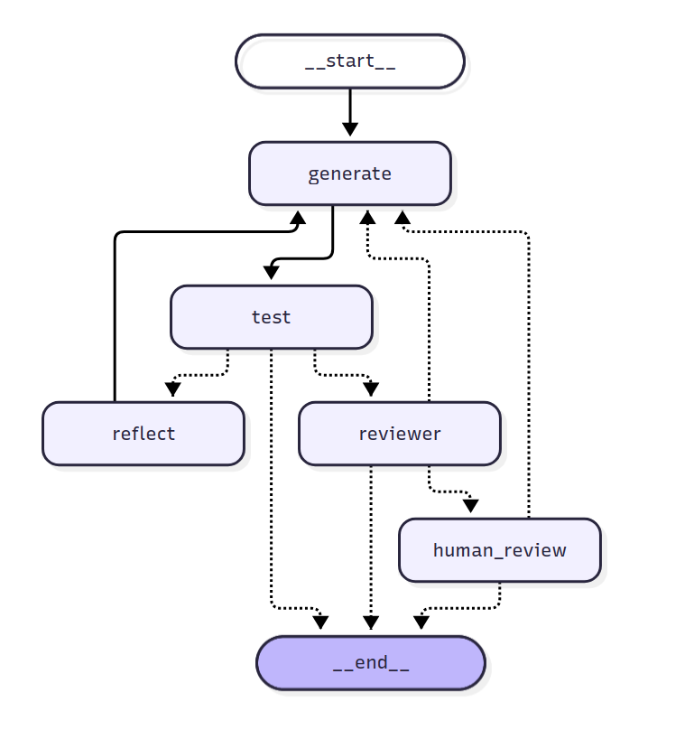
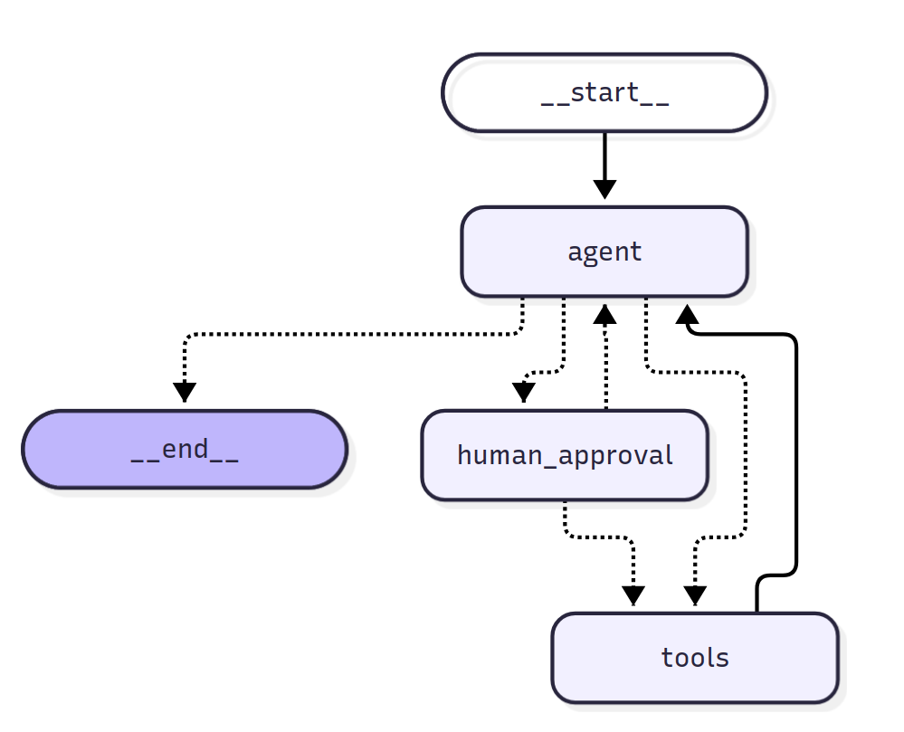
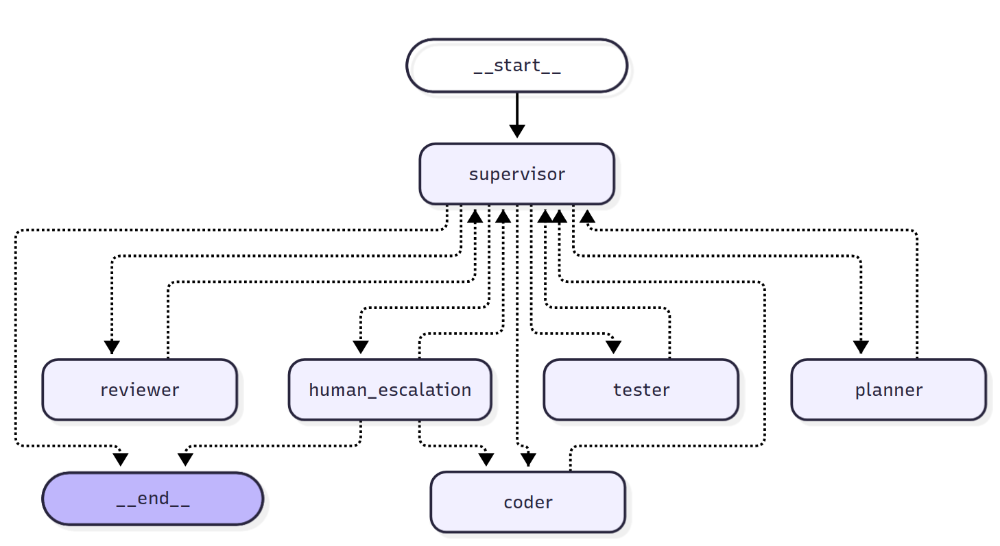

# LangGraph Workshop — Homework (Module 3)

One file per task, a short note on each: what surprised me, and where the model needed a guard in code.
Graphs are the output of `python homework/taskN.py --mermaid`.

| Task | File | Run |
|---|---|---|
| 1 · Memory that survives a restart | `task1.py` | `python homework/task1.py "My name is Alex"` |
| 2 · AI reviewer instead of a human | `task2.py` | `python homework/task2.py` |
| 3 · Time travel | `task3_solution.py`, `task3_result.py` | `python homework/task3_solution.py` then `python homework/task3_result.py` |
| 4 · Notes assistant with real tools | `task4.py` | `python homework/task4.py` |
| 5 · Parallel candidates with `Send` | `task5.py` | `python homework/task5.py` |
| 6 · A safer supervisor | `task6.py` | `python homework/task6.py --picky-reviewer` |

---

## Task 1 · Memory that survives a restart

The model itself remembers nothing: "memory" is only the SQLite checkpointer loading the saved messages for a `thread_id`, so a new thread or deleting `memory.db` makes the agent forget at once. The guard in code is for a thread that was stopped while waiting for an approval: that pause is saved in `memory.db` too, so the script settles it first before it accepts a new message.

## Task 2 · Replace the human reviewer with an AI reviewer

The reviewer asked only for a docstring (the type hints were already in the task's signature), so how strict it is depends entirely on the criteria I wrote in its prompt, and it still approved code that did more than the task asked. The guard is code, not the LLM: `review_rejections` counts rejections in state and `after_review` sends the run to the human only after the second one; I also had to relax the coder's "no docstring" rule, or it would fight the reviewer.

## Task 3 · Time travel

One injected sentence ("Use a regular expression with re.fullmatch") made the forked run pass in a single attempt, while the original run gave up after three; the fork is its own branch, and the history grew from 10 to 15 checkpoints. The guard: after the human-review pause the replay must resume on the thread's latest checkpoint, because resuming with the config of the forked checkpoint restarts the fork again and loops forever (I caught it in an offline test).

## Task 4 · Your own agent with real tools

A rejected tool call still needs a `ToolMessage` reply for every `tool_call`, otherwise the next model call fails, so the human's feedback travels back as a tool result and the agent revises its text. Two guards live in code: `route` sends only `write_note` through approval, and `safe_path` accepts only a plain file name that resolves inside `notes/`, because a path chosen by the model cannot be trusted.

## Task 5 · Parallel candidates with `Send`

All three differently-prompted candidates failed on the same hidden requirements (whitespace and case), so parallel variety did not help and the old `reflect` → `generate` loop fixed it in one more attempt. Two guards: `candidates` needs the `operator.add` reducer (without it three parallel writes to one key raise `InvalidUpdateError`), and `pick_best` sorts candidates by their hint position, because they finish in any order and "first that passes" must be well defined.

## Task 6 · Make the supervisor safer

Two limits interact: the old `MAX_TURNS = 14` stopped a long run before the call budget could, so I raised it to 20 to let the budget be the limit that binds first. Both new guards are plain code that runs before the router model is asked: three reviewer rejections in a row call `interrupt()` for a human (`continue`, `finish`, or instructions for the coder), and the budget check stops the run before the total could exceed `MAX_LLM_CALLS`, followed by a per-agent call table.
