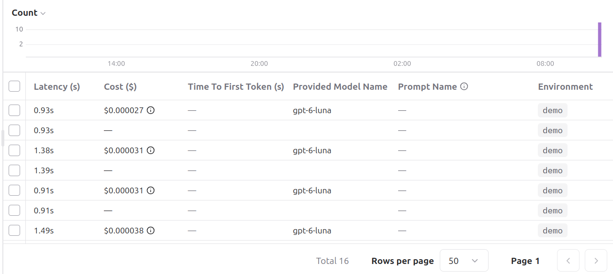
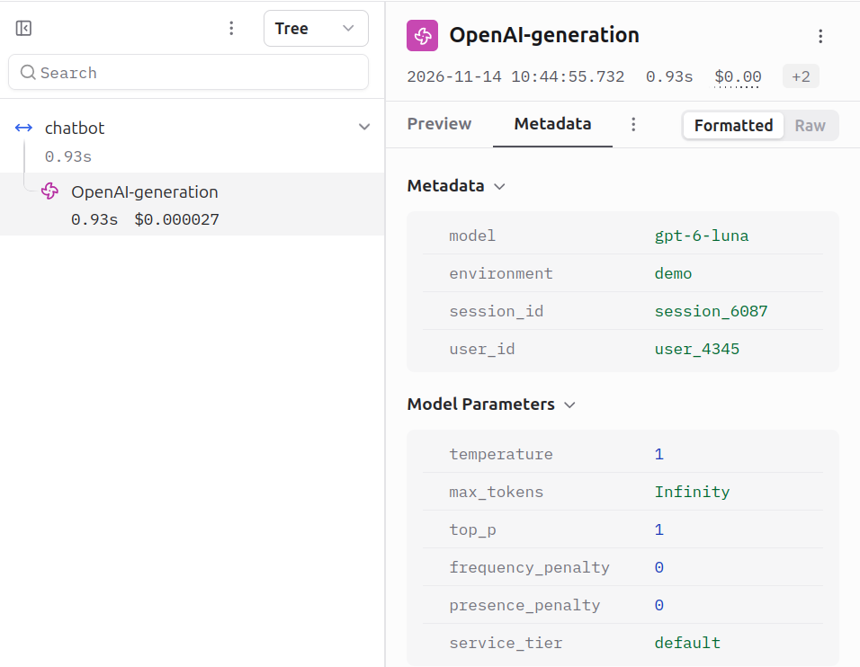
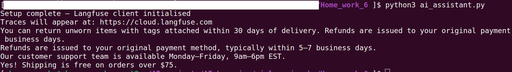
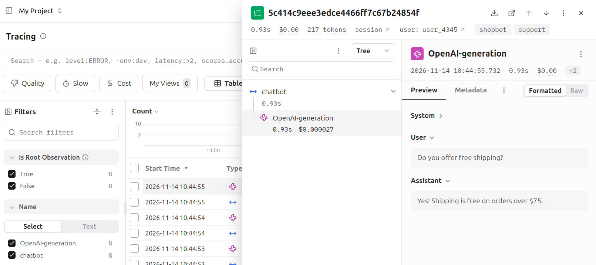

# ai-observability

## How to execute

Export environment variables for LangFuse and OpenAI properties
Install dependencies and run script. Check result at https://cloud.langfuse.com

```
python3 -m venv ./venv
source ./venv/bin/activate
pip3 install -r requirements.txt
python3 ai_assistant.py
```

## My results

Script successfully executed, metrics available. Evidences on the screenshots.








